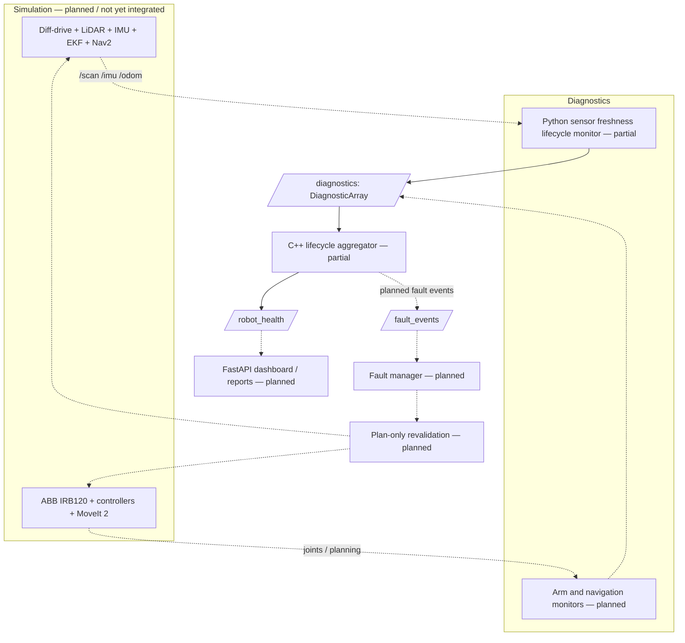

# Architecture — native Ubuntu-first roadmap

**Runtime baseline:** Ubuntu 24.04, ROS 2 Jazzy, Gazebo Harmonic 8.x (future
Phase 2), Python 3.12, C++17. Development and ROS debugging are native;
container testing is supplementary CI evidence, not a local prerequisite.

## Available interfaces

| Kind | Name | Type | Stage |
|---|---|---|---|
| Topic | `/diagnostics` | `diagnostic_msgs/msg/DiagnosticArray` | Implemented by sensor monitor |
| Topic | `/robot_health` | `rhm_interfaces/msg/HealthStatus` | Partial, mobile only |
| Topic | `/fault_events` | `rhm_interfaces/msg/FaultEvent` | Publisher declared; events not generated |
| Topic | `/recommendations` | `rhm_interfaces/msg/Recommendation` | Definition only |
| Service | `/rhm/get_report` | `rhm_interfaces/srv/GetReport` | Partial mobile snapshot |
| Service | `/rhm/reset_faults` | `rhm_interfaces/srv/ResetFaults` | Explicitly unsupported response |
| Service | `/fault_injector/inject` | `rhm_interfaces/srv/InjectFault` | Definition only; no injector |
| Action | `/fault_manager/revalidate_plan` | `rhm_interfaces/action/RevalidatePlan` | Definition only |

`rhm_bringup` launches the current monitor and aggregator **without** a
simulator or robot. `scripts/activate_native.sh` performs explicit lifecycle
transitions. ROS topic data from missing sensors is expected to be `STALE`.

## ROS QoS and clock decisions

- Input `/scan`, `/imu`, `/odom`: sensor-data QoS (best-effort).
- Output `/diagnostics`, `/robot_health`: reliable / volatile / depth 10.
- ROS clock is used for all sample ages. Native starts with
  `use_sim_time: false`; Gazebo launch will switch it on when `/clock` exists.
- Standalone nodes use the default single-threaded executor. Both Python
  sample observations and C++ aggregator samples are lock protected.
- Changes to health thresholds require a restart: they are startup-only and
  protected by read-only ParameterDescriptors.

## Next engineering sequence

1. Close revised-native build, tests, and lifecycle smoke gates on host.
2. Add `rhm_description` and `rhm_sim`: diff-drive model with Gazebo sensor
   plugins and collision-only IRB120 scene, deterministic spawn and TF tests.
3. Extend `rhm_monitors` into mobile battery/thermal/stall/TF/EKF/Nav2 and
   arm joint/controller/planning monitors. Pure logic unit tested first.
4. Finish C++ aggregator: two assets, fault events, latches/reset, hysteresis,
   health scores, and integration fault injection.
5. Add planning-only fault manager, predictive trends, scenario runner,
   FastAPI dashboard, reporting and RAPID template (sim only).
6. Run Docker CI, coverage, lint, and clean-clone tests for release.

## TF contracts for simulation (not verified)

Mobile: `map → odom → base_link → {laser_link, imu_link, wheel links}`.
Only one component owns `map→odom` and one owns `odom→base_link`.

Arm: `world → base_link → arm links → tool0`; link names and joint origins
must be verified against a legally redistributable ABB description before
integration. No kinematic equivalence is claimed for a substitute model.

## Safety scope

No real robot command path, execution approval, collision guarantee, hardware
safety rating, or physical fault injection exists in this baseline. A valid
planning response alone is not permission to move a robot.
