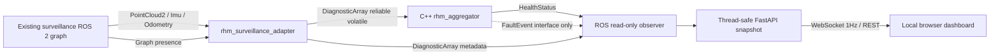

# Surveillance health adapter + dashboard

## Purpose and non-goals

The surveillance project owns the robot and runs independently. This project
observes its ROS graph; no surveillance code is copied. The ROS-only adapter
publishes `/rhm/surveillance/diagnostics` to the existing aggregator, which publishes
`/robot_health`. A separate ROS observer feeds the FastAPI server.



## QoS

Sensor adapter subscriptions: `qos_profile_sensor_data` (best effort, volatile,
small queue), matching usual ROS sensor publishers. `/rhm/surveillance/diagnostics`,
`/robot_health`, and `/fault_events` use reliable/volatile, keep-last 10.
Server subscriber uses reliable/volatile. These contracts should be checked
against real publishers using `ros2 topic info -v`.

## Timestamp and rate semantics

Sensor freshness uses the ROS clock at message reception. A message containing
old or invalid payload can still count as received: **data content quality is
not yet checked.** Rate is an EWMA of observed inter-arrival intervals; no
value is shown before two samples. ROS clock regressions reset the estimator.
When sim-time is enabled, `/clock` must be active. WebSocket and API responsiveness
use wall time, but do not participate in robot health calculations.

## Safety and privacy

Only subscribers and diagnostic publishers exist. The adapter does not call
Nav2, MoveIt, motor services, or hardware interfaces. Browser access defaults
to 127.0.0.1. Setting a non-loopback bind requires `RHM_DASHBOARD_TOKEN` from
the environment. Token-authenticated WebSockets transmit credentials as their
first message, not in URL parameters. The client stores the token in tab-scoped
`sessionStorage`. Avoid publicly exposing this local development server.

## Feature truth table

| Feature | State |
|---|---|
| ROS sensor freshness + observed rate | Implemented source, pending surveillance runtime |
| ROS graph node presence | Implemented; NOT lifecycle state verification |
| C++ health aggregation | Pre-existing basic implementation |
| Dashboard live health, time-series, status table | Implemented; pending ROS runtime |
| Event timeline of observed health transitions | Implemented |
| `/fault_events` display | Subscriber only, existing generator unimplemented |
| Battery, motor heat, camera quality, GNSS accuracy | Not implemented |
| Navigation/SLAM failures and recovery recommendations | Not implemented |
| ABB IRB120 | Not connected |
| Robot control from dashboard | Deliberately absent |

## Operational validation procedure

1. Confirm `ros2 topic list -t` shows mapped topics on domain 188.
2. Run `bash scripts/run_surveillance.sh`, inspect the startup lifecycle states.
3. Visit `http://127.0.0.1:8765` and verify *actual* subsystem values. If a
   stream is absent, expect STALE/unknown, not a green status.
4. Stop one *simulated* sensor publisher, without disrupting safety controls;
   record output times of `/rhm/surveillance/diagnostics` and `/robot_health`. Do not claim an
   empirical detection latency until a timed run is captured.
5. Restore the topic and verify health recovers after debounce.
6. Run `bash scripts/verify_surveillance.sh` and retain logs.

Do not perform deliberate sensor failures on a live moving robot without
approved safety measures; simulator testing is the intended workflow.

### Separate live evidence gate

With the external seaport simulation and `run_surveillance.sh` running, execute
in a separate terminal:

```bash
cd ~/robot-health-project/rhm-native
source /opt/ros/jazzy/setup.bash
source install/setup.bash
export ROS_DOMAIN_ID=188
python3 scripts/check_surveillance_live.py --timeout 30
# Strict version requiring healthy LiDAR reception:
python3 scripts/check_surveillance_live.py --timeout 30 --require-lidar-ok
```

Do not call either gate a pass unless it returns exit code 0 and logs a live
subsystem record. `RHM_LIVE_CHECK=1 bash scripts/verify_surveillance.sh` also
runs the live gate and checks API process readiness (not browser rendering).
The checker does not inject faults or send movement commands.

## CI

The Docker verification image now includes pinned dashboard Python dependencies
and runs the adapter + dashboard's non-ROS unit/API tests, in addition to the
existing ROS build/test gates. This branch's CI is **not yet run**. The default
base image remains a moving tag; immutable digest pinning is still outstanding.

The adapter publishes to `/rhm/surveillance/diagnostics`, not the global
`/diagnostics`, so it does not inject records into the surveillance project's
existing diagnostic stream. Launch-time topic remapping binds the unchanged
aggregator's `/diagnostics` subscriber to this isolated RHM topic.
